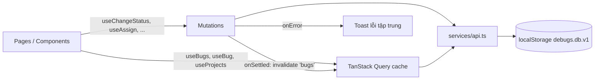

# Architecture

## Stack

| Lớp | Công nghệ | Ghi chú |
|---|---|---|
| Build | Vite 8, TypeScript 6.0 | TS ghim 6.0 vì typescript-eslint chưa hỗ trợ TS 7 |
| UI | React 19, Tailwind CSS 4, shadcn/ui (Radix), Lucide | Token trong `src/index.css` |
| Routing | React Router DOM 7 — `createHashRouter` | URL dạng `/#/FF/board`; trang form lazy-load |
| Server state | TanStack Query 5 | Optimistic update khi đổi trạng thái |
| Bảng | TanStack Table 8 | Sắp xếp + phân trang |
| Form | React Hook Form + Zod 4 | Thông điệp lỗi là key i18n |
| Toast | Sonner | Lỗi mutation báo tập trung trong `MutationCache` |

Không dùng (có cân nhắc): **Zustand** — chỉ 2 giá trị toàn cục (ngôn ngữ, người dùng hiện tại), dùng `useSyncExternalStore` (`lib/persisted-store.ts`); **date-fns** — `Intl.DateTimeFormat`/`RelativeTimeFormat` có sẵn đủ 4 locale; **Recharts, cmdk, React Day Picker, Framer Motion** — không có chức năng nào trong spec cần; **dnd-kit** — HTML5 drag & drop gốc + menu thay thế cho bàn phím/touch.

## Cấu trúc thư mục

```text
src/
├── app/                    # khung ứng dụng
│   ├── layouts/app-layout.tsx   sidebar + header + Sheet mobile + skip link
│   ├── providers.tsx            QueryClient, Toaster
│   ├── router.tsx               định nghĩa route
│   └── not-found-page.tsx
├── components/
│   ├── ui/                 # shadcn/ui (đã chỉnh focus ring 2px đặc)
│   └── common/             # badges, field (Field/FieldSet), section, states, user-avatar
├── features/
│   ├── bugs/
│   │   ├── bug-form-schema.ts   zod schema + chuyển form → BugInput
│   │   ├── components/          release-status, bug-table, bug-filters, kanban-board,
│   │   │                        status-stepper, history-list, image-gallery, image-field, bug-form
│   │   ├── hooks/               use-bug-filters (URL), use-scope (outlet context)
│   │   └── pages/               scope-layout, bug-list, board, bug-detail, bug-form
│   └── projects/components/     project-nav, new-project-dialog
├── hooks/use-document-title.ts
├── i18n/                   # vi (nguồn), en, zh-Hant, zh-Hans + useI18n
├── lib/                    # rules (nghiệp vụ), meta (màu/icon), image, persisted-store, utils
├── services/               # api (mock), queries (TanStack), seed, current-user
└── types/                  # model dữ liệu
scripts/
├── rules.test.ts           # test quy tắc nghiệp vụ (node)
└── e2e.mjs                 # E2E Playwright trên bản build
```

## Luồng dữ liệu



- **Quy tắc nghiệp vụ** nằm ở một chỗ: `lib/rules.ts` (`isMustFix`, `isBlocking`, `releaseStatus`, `formatBugCode`). Sidebar, ô release, bảng, Kanban, chi tiết đều gọi các hàm này.
- **Sinh mã bug** chỉ ở `api.createBug` (`project.nextSeq++`); xóa bug không giảm `nextSeq`.
- **Lịch sử** chỉ được ghi trong `api` (`create`, `claim`, `assign`, `unassign`, `status`, `edit`), lưu mã hành động để dịch khi hiển thị.
- **Bộ lọc** nằm trên URL (`?q=&platform=&core=&status=`), sắp xếp/phân trang là state cục bộ của bảng.

## Tích hợp backend thật

Thay thân các hàm trong `services/api.ts` bằng `fetch` — chữ ký giữ nguyên nên `queries.ts` và UI không đổi:

| Hàm | Endpoint gợi ý |
|---|---|
| `listProjects` / `createProject` | `GET/POST /projects` |
| `listBugs` / `getBug(code)` | `GET /bugs`, `GET /bugs/:code` (kèm `images`, `history`) |
| `createBug` | `POST /bugs` — server sinh `seq`/`code` trong transaction |
| `updateBug` | `PATCH /bugs/:code` |
| `changeStatus` / `assign` | `POST /bugs/:code/status`, `POST /bugs/:code/assignee` — server ghi `bug_history` |
| `deleteBug` | `DELETE /bugs/:code` |

Lỗi trả về cần map sang `ApiError` với `code` ∈ `not_found | duplicate_key | invalid_key | storage_full` (thêm mã mới vào `error.*` trong i18n). `getCurrentUser()` thay bằng user đăng nhập. Ảnh: upload file lên storage, chỉ lưu URL (bỏ `lib/image.ts` data URL).

## Routing & deploy (hash URL)

- `createHashRouter`: route nằm sau `#` (`/#/all`, `/#/FF/board`, `/#/bugs/FF-001`). Server chỉ cần trả file tĩnh, **không cần rewrite** mọi đường dẫn về `index.html`.
- `vite.config.ts` đặt `base: './'` → asset dùng đường dẫn tương đối; thư mục `dist/` chạy được ở gốc domain hoặc thư mục con bất kỳ (đã kiểm: `/tools/debugs/#/bugs/FF-002` mở thẳng, tải lại và tải chunk lazy đều chạy).
- Không dùng `href="#..."` để cuộn/neo trong trang — router sẽ hiểu là route. Link "Bỏ qua đến nội dung" chỉ chuyển focus vào `<main>` bằng `onClick`.
- Đổi hash là điều hướng trong cùng tài liệu: script kiểm thử đi qua `about:blank` trước mỗi `goto` để mô phỏng mở link mới.
