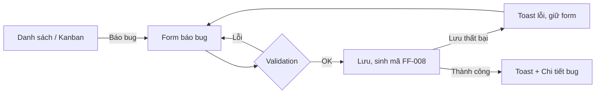
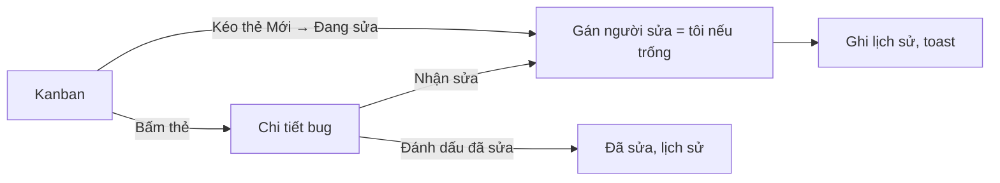
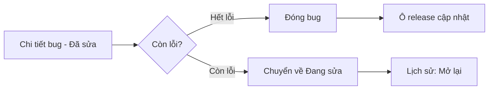
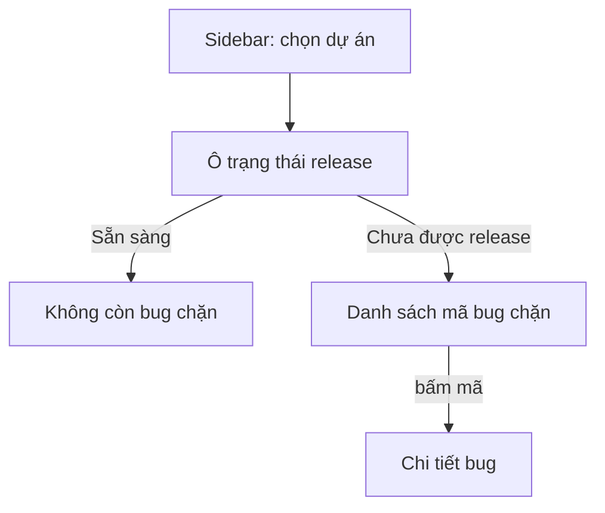
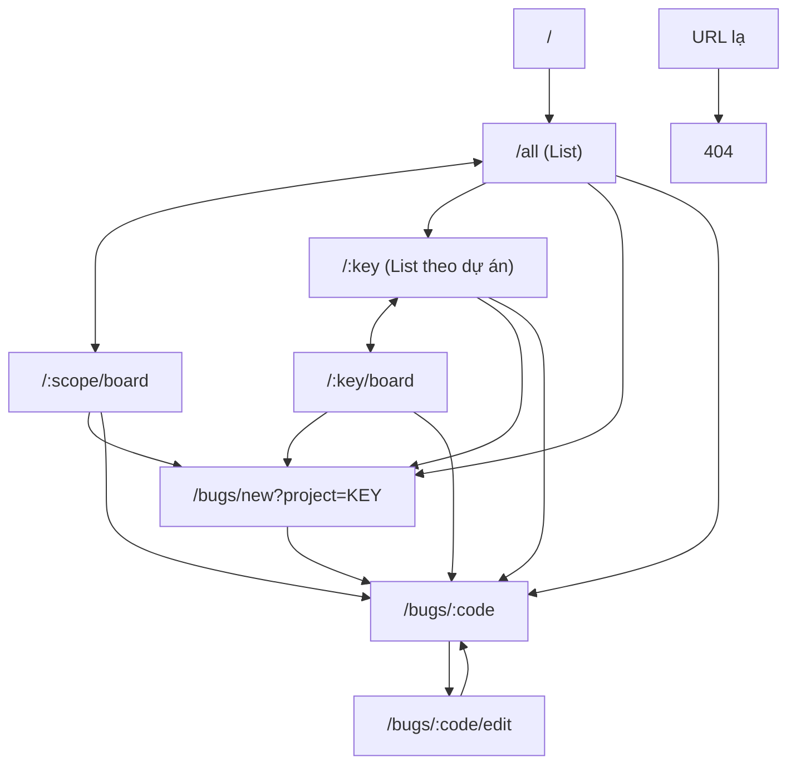

# User flow

## Entry point

`/` → chuyển đến `/all` (Danh sách bug, tất cả dự án). Ngôn ngữ và người dùng hiện tại khôi phục từ lần trước.

## 1. Báo bug (người báo)

- Alternative: Hủy → quay lại trang trước.
- Dự án mặc định = dự án đang xem ở sidebar (nếu ở "Tất cả" thì bắt buộc chọn).

## 2. Nhận và sửa bug (người sửa)

## 3. Kiểm tra lại và đóng (người báo)

## 4. Kiểm tra release

## 5. Tạo dự án

Sidebar "+ Dự án mới" → Dialog → nhập key/tên/tính năng cốt lõi → Lưu → điều hướng `/KEY`. Lỗi trùng key hiện tại trường.

## 6. Xóa bug

Chi tiết → Xóa → AlertDialog xác nhận → xóa → toast → về danh sách dự án. Số thứ tự không được tái sử dụng.

## Navigation map

## Error flows chung

| Tình huống | Xử lý |
|---|---|
| Mã bug / key dự án không tồn tại | Trang "Không tìm thấy" + link về danh sách |
| Lưu thất bại (localStorage đầy, lỗi) | Toast lỗi, dữ liệu giữ nguyên |
| Tải dữ liệu lỗi | Khối lỗi + nút "Thử lại" |
